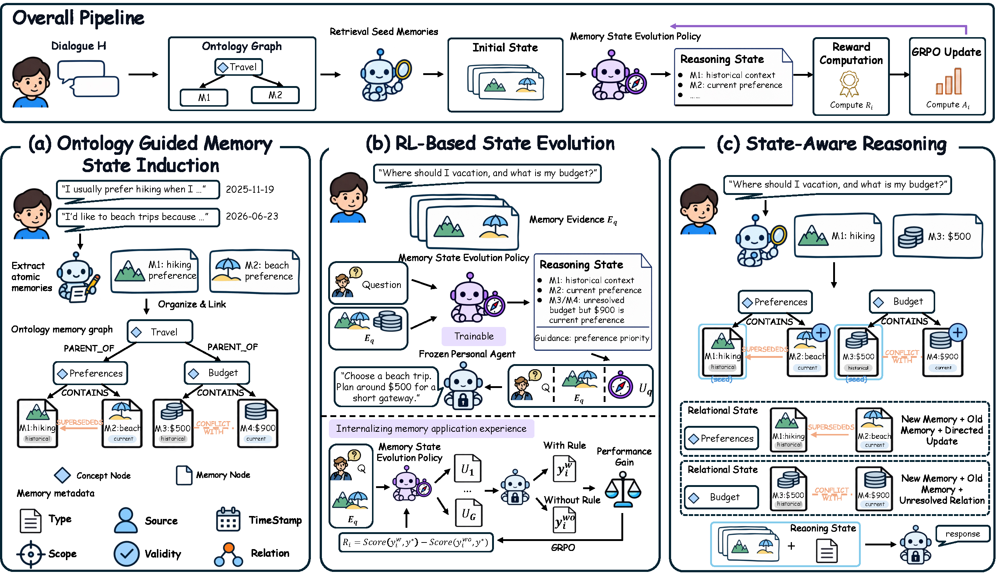

# EvoMemState: Evolving Memory State for Personal Agents

## 💡 Overview

Personal agents need to remember what a user said, track how that information changes, and decide how it should affect the current request. **EvoMemState** stores Persistent Facts in an evolving memory ontology. Retrieval produces a request-specific Relational State, and a policy generates a Reasoning State to guide a frozen response model.

1. **Ontology-Guided Memory State Induction** extracts Persistent Facts from dialogue and organizes them in a personal memory ontology. The ontology maintains validity, scope, source, time, and relations such as `SUPERSEDES` and `CONFLICTS_WITH`.
2. **RL-Based State Evolution** retrieves a Relational State containing relevant memories and their relations, then trains a Memory State Evolution Policy to generate a Reasoning State. The policy learns from the change in answer quality when that Reasoning State is supplied to a frozen response model.
3. **State-Aware Reasoning** combines the Relational State and generated Reasoning State to produce the final response.

<p align="center">
  
</p>

The figure shows the full method from the manuscript, including policy training. This repository includes inference, GRPO policy training and the slime backend. Training data and model checkpoints are supplied separately.

## 📊 Main results

The complete main table from the EvoMemState manuscript is reproduced below. All values are on a 0–100 scale. **Bold** and <ins>underlined</ins> values mark the best and second-best results within each response model, following the manuscript. Higher is better (↑), except for sycophancy rate (↓). Averages are copied directly from the paper.

<table>
  <thead>
    <tr>
      <th rowspan="2">Memory system</th>
      <th colspan="5">MemSyco-Bench</th>
      <th colspan="5">MemTrapBench</th>
      <th colspan="2">LoCoMo-Refined</th>
      <th colspan="2">LoCoMo</th>
      <th rowspan="2">Overall Avg. ↑</th>
    </tr>
    <tr>
      <th>WTU Acc. ↑</th>
      <th>WTU Syco. ↓</th>
      <th>HTU Acc. ↑</th>
      <th>HTU Use ↑</th>
      <th>Avg. ↑</th>
      <th>Safety Score ↑</th>
      <th>CogBias Acc. ↑</th>
      <th>Bound. Acc. ↑</th>
      <th>Trauma Acc. ↑</th>
      <th>Avg. ↑</th>
      <th>Judge Score ↑</th>
      <th>Token F1 ↑</th>
      <th>Judge Score ↑</th>
      <th>Token F1 ↑</th>
    </tr>
  </thead>
  <tbody>
    <tr><th colspan="16">Response model: Qwen3-8B</th></tr>
    <tr>
      <td>NaiveRAG</td>
      <td align="right">36.3</td><td align="right">55.3</td><td align="right">51.6</td><td align="right">64.0</td><td align="right">42.4</td><td align="right">60.2</td><td align="right">63.9</td><td align="right">77.0</td><td align="right"><ins>93.4</ins></td><td align="right">73.6</td><td align="right">39.0</td><td align="right">38.4</td><td align="right">34.4</td><td align="right">35.8</td><td align="right">47.4</td>
    </tr>
    <tr>
      <td>MemGPT</td>
      <td align="right">29.0</td><td align="right">66.7</td><td align="right">54.0</td><td align="right">67.0</td><td align="right">39.0</td><td align="right">62.2</td><td align="right">66.0</td><td align="right">64.5</td><td align="right">52.4</td><td align="right">61.3</td><td align="right">45.7</td><td align="right">40.0</td><td align="right">36.8</td><td align="right">37.0</td><td align="right">45.7</td>
    </tr>
    <tr>
      <td>MemoryBank</td>
      <td align="right">37.5</td><td align="right">57.6</td><td align="right">54.4</td><td align="right">67.1</td><td align="right">44.2</td><td align="right">64.9</td><td align="right">63.7</td><td align="right">72.1</td><td align="right">82.3</td><td align="right">70.7</td><td align="right">44.9</td><td align="right">44.0</td><td align="right">39.9</td><td align="right">41.0</td><td align="right">49.9</td>
    </tr>
    <tr>
      <td>Mem0</td>
      <td align="right">25.9</td><td align="right"><ins>47.8</ins></td><td align="right">52.0</td><td align="right">63.8</td><td align="right">36.3</td><td align="right">56.8</td><td align="right"><ins>69.3</ins></td><td align="right">81.9</td><td align="right">85.5</td><td align="right">73.4</td><td align="right">25.7</td><td align="right">26.9</td><td align="right">21.4</td><td align="right">23.8</td><td align="right">39.2</td>
    </tr>
    <tr>
      <td>A-MEM</td>
      <td align="right"><ins>42.8</ins></td><td align="right">49.1</td><td align="right">49.2</td><td align="right">61.2</td><td align="right"><ins>45.4</ins></td><td align="right">64.2</td><td align="right">65.0</td><td align="right">77.6</td><td align="right">91.8</td><td align="right">74.6</td><td align="right">41.8</td><td align="right">39.1</td><td align="right">36.4</td><td align="right">37.1</td><td align="right">49.6</td>
    </tr>
    <tr>
      <td>LightMem</td>
      <td align="right">21.0</td><td align="right">49.6</td><td align="right">46.1</td><td align="right">58.7</td><td align="right">31.0</td><td align="right">68.6</td><td align="right"><strong>69.9</strong></td><td align="right"><ins>88.6</ins></td><td align="right">91.6</td><td align="right"><ins>79.7</ins></td><td align="right">25.3</td><td align="right">27.2</td><td align="right">22.1</td><td align="right">24.0</td><td align="right">39.5</td>
    </tr>
    <tr>
      <td>Supermemory</td>
      <td align="right">23.3</td><td align="right">70.5</td><td align="right"><ins>63.7</ins></td><td align="right"><ins>74.2</ins></td><td align="right">39.5</td><td align="right">67.5</td><td align="right">65.4</td><td align="right">79.6</td><td align="right">61.7</td><td align="right">68.6</td><td align="right">16.6</td><td align="right">17.5</td><td align="right">15.7</td><td align="right">15.8</td><td align="right">35.1</td>
    </tr>
    <tr>
      <td>SimpleMem</td>
      <td align="right">33.4</td><td align="right">58.6</td><td align="right">44.1</td><td align="right">52.6</td><td align="right">37.7</td><td align="right">70.9</td><td align="right">68.3</td><td align="right">84.6</td><td align="right"><strong>95.8</strong></td><td align="right"><strong>79.9</strong></td><td align="right"><ins>51.3</ins></td><td align="right"><ins>46.6</ins></td><td align="right"><ins>45.3</ins></td><td align="right"><strong>46.4</strong></td><td align="right"><ins>53.6</ins></td>
    </tr>
    <tr>
      <td>PGMem</td>
      <td align="right">33.2</td><td align="right">62.8</td><td align="right">54.5</td><td align="right">69.1</td><td align="right">41.8</td><td align="right"><ins>71.0</ins></td><td align="right">66.4</td><td align="right">85.1</td><td align="right">75.6</td><td align="right">74.5</td><td align="right">28.5</td><td align="right">26.9</td><td align="right">25.4</td><td align="right">25.2</td><td align="right">42.6</td>
    </tr>
    <tr>
      <td><strong>EvoMemState (Ours)</strong></td>
      <td align="right"><strong>47.7</strong></td><td align="right"><strong>38.0</strong></td><td align="right"><strong>72.4</strong></td><td align="right"><strong>81.3</strong></td><td align="right"><strong>57.6</strong></td><td align="right"><strong>73.8</strong></td><td align="right">62.3</td><td align="right"><strong>88.8</strong></td><td align="right">91.4</td><td align="right">79.1</td><td align="right"><strong>57.4</strong></td><td align="right"><strong>47.3</strong></td><td align="right"><strong>45.5</strong></td><td align="right"><ins>41.6</ins></td><td align="right"><strong>59.9</strong></td>
    </tr>
    <tr><th colspan="16">Response model: GPT-4o-mini</th></tr>
    <tr>
      <td>NaiveRAG</td>
      <td align="right">48.3</td><td align="right">42.8</td><td align="right">49.2</td><td align="right">61.1</td><td align="right">48.7</td><td align="right">61.7</td><td align="right">58.6</td><td align="right">65.0</td><td align="right"><strong>97.4</strong></td><td align="right">70.7</td><td align="right">43.2</td><td align="right">39.1</td><td align="right">34.4</td><td align="right">36.9</td><td align="right">49.3</td>
    </tr>
    <tr>
      <td>MemGPT</td>
      <td align="right">40.8</td><td align="right">48.0</td><td align="right"><ins>56.2</ins></td><td align="right">66.0</td><td align="right">46.9</td><td align="right">66.4</td><td align="right">60.7</td><td align="right">69.9</td><td align="right">62.3</td><td align="right">64.8</td><td align="right">49.1</td><td align="right">39.5</td><td align="right">40.2</td><td align="right">39.1</td><td align="right">50.3</td>
    </tr>
    <tr>
      <td>MemoryBank</td>
      <td align="right">48.9</td><td align="right">42.2</td><td align="right">48.3</td><td align="right">62.3</td><td align="right">48.7</td><td align="right">66.4</td><td align="right">59.8</td><td align="right">73.4</td><td align="right">90.5</td><td align="right">72.5</td><td align="right">52.8</td><td align="right">46.6</td><td align="right">42.7</td><td align="right"><ins>45.3</ins></td><td align="right"><ins>54.2</ins></td>
    </tr>
    <tr>
      <td>Mem0</td>
      <td align="right">32.7</td><td align="right">38.4</td><td align="right">50.3</td><td align="right">63.3</td><td align="right">39.7</td><td align="right">56.4</td><td align="right">61.7</td><td align="right">74.1</td><td align="right">93.5</td><td align="right">71.4</td><td align="right">28.9</td><td align="right">27.2</td><td align="right">21.6</td><td align="right">25.2</td><td align="right">40.4</td>
    </tr>
    <tr>
      <td>A-MEM</td>
      <td align="right"><strong>54.5</strong></td><td align="right"><ins>35.7</ins></td><td align="right">50.9</td><td align="right">63.1</td><td align="right"><ins>53.0</ins></td><td align="right">63.1</td><td align="right">59.6</td><td align="right">69.3</td><td align="right">95.8</td><td align="right">71.9</td><td align="right">49.1</td><td align="right">42.7</td><td align="right">39.4</td><td align="right">41.9</td><td align="right">53.4</td>
    </tr>
    <tr>
      <td>LightMem</td>
      <td align="right">25.0</td><td align="right">42.9</td><td align="right">46.9</td><td align="right">60.4</td><td align="right">33.8</td><td align="right">70.2</td><td align="right">63.8</td><td align="right">80.8</td><td align="right">95.2</td><td align="right"><ins>77.5</ins></td><td align="right">24.2</td><td align="right">26.9</td><td align="right">21.8</td><td align="right">25.1</td><td align="right">39.3</td>
    </tr>
    <tr>
      <td>Supermemory</td>
      <td align="right">35.0</td><td align="right">56.3</td><td align="right">52.9</td><td align="right">65.9</td><td align="right">42.2</td><td align="right">67.4</td><td align="right">58.8</td><td align="right">74.2</td><td align="right">76.4</td><td align="right">69.2</td><td align="right">15.8</td><td align="right">16.0</td><td align="right">14.9</td><td align="right">14.8</td><td align="right">35.5</td>
    </tr>
    <tr>
      <td>SimpleMem</td>
      <td align="right">25.0</td><td align="right">63.2</td><td align="right">47.6</td><td align="right">60.7</td><td align="right">34.0</td><td align="right">69.7</td><td align="right"><ins>64.6</ins></td><td align="right">72.7</td><td align="right"><ins>97.3</ins></td><td align="right">76.1</td><td align="right"><ins>53.8</ins></td><td align="right"><ins>48.0</ins></td><td align="right"><strong>47.2</strong></td><td align="right"><strong>48.4</strong></td><td align="right">52.8</td>
    </tr>
    <tr>
      <td>PGMem</td>
      <td align="right">39.6</td><td align="right">54.4</td><td align="right">53.7</td><td align="right"><ins>66.3</ins></td><td align="right">45.2</td><td align="right"><ins>73.9</ins></td><td align="right">60.9</td><td align="right"><ins>81.1</ins></td><td align="right">83.1</td><td align="right">74.7</td><td align="right">19.8</td><td align="right">18.9</td><td align="right">16.7</td><td align="right">17.6</td><td align="right">39.1</td>
    </tr>
    <tr>
      <td><strong>EvoMemState (Ours)</strong></td>
      <td align="right"><ins>53.1</ins></td><td align="right"><strong>31.9</strong></td><td align="right"><strong>67.6</strong></td><td align="right"><strong>80.1</strong></td><td align="right"><strong>58.9</strong></td><td align="right"><strong>73.9</strong></td><td align="right"><strong>73.9</strong></td><td align="right"><strong>88.8</strong></td><td align="right">90.4</td><td align="right"><strong>78.7</strong></td><td align="right"><strong>60.8</strong></td><td align="right"><strong>48.5</strong></td><td align="right"><ins>46.4</ins></td><td align="right">45.2</td><td align="right"><strong>61.2</strong></td>
    </tr>
  </tbody>
</table>

WTU/HTU: When/How to Use memory. Syco.: sycophancy rate. Use: correct use. CogBias: cognitive bias. Bound.: boundary. The table reports manuscript results; the commands below describe how to run inference.

## 🥑 Repository structure

```text
.
├── README.md
├── .env.example                    # Endpoint configuration template
├── assets/evomemstate_framework.png # Manuscript framework
├── config/                         # Ontology and benchmark configuration
├── evomemstate/
│   ├── builder.py                  # Memory construction
│   ├── extractor.py                # Ontology-guided extraction
│   ├── ontology.py                 # Persistent ontology and updates
│   ├── retrieval.py                # Relational State retrieval
│   ├── reasoning_state.py          # Reasoning State inference
│   ├── reasoning_state_reward.py   # Frozen-answer improvement reward
│   ├── reasoning_state_policy.py   # Policy prompts and training records
│   ├── training_data.py            # External manifest conversion
│   ├── slime_step_info.py          # Rollout metrics
│   ├── prompting.py                # Context for the answer model
│   ├── harness/                    # Context pipeline and rules
│   ├── memsyco_adapter.py          # MemSyco integration
│   ├── memtrap_adapter.py          # MemTrap integration
│   └── run_locomo.py               # LoCoMo-Refined inference
├── slime/                          # Vendored GRPO training backend
├── scripts/                        # Training and benchmark entry points
├── docs/                           # Installation and implementation notes
├── tests/                          # Offline checks
├── envs/                           # Environment definitions
├── pyproject.toml
└── requirements.txt
```

`datasets/` and `outputs/` are local runtime directories ignored by Git.

## 🚀 Run

### 1. Install dependencies

From the repository root, using Python 3.12:

```bash
pip install -e .
pip install -r datasets/MemSyco-Bench/requirements.txt
```

Place MemSyco-Bench at `datasets/MemSyco-Bench` first. Copy `.env.example` to `.env` and fill `MEMORY_*`, `REASONING_STATE_*`, `GEN_B_*`, and `JUDGE_*` with your model names, endpoints, and keys. Keep credentials in `.env`.

### 2. Build memory graphs

```bash
bash scripts/install_memsyco_adapter.sh
python -m evomemstate.prebuild_graphs --tasks all --limit 3
```

### 3. Run inference

```bash
MODE=smoke bash scripts/run_evomemstate_memsyco.sh
```

The runner loads `.env`, reuses existing graphs, and runs inference and scoring on three examples per task. Results are saved to `outputs/evomemstate_memsyco/`. Use `--limit 0` for full graph construction and `MODE=full` for full inference.

### 4. Train the Reasoning State policy (GRPO)

Requires a Linux CUDA training environment with PyTorch, SGLang, Megatron-LM and compatible fused kernels installed. Install the included backend:

```bash
pip install -e ./slime
```

Supply a policy checkpoint, its converted Megatron `torch_dist` checkpoint and prepared training JSONL. Set the frozen answer endpoint in your local environment, then train:

```bash
export MEGATRON_PATH=/path/to/Megatron-LM
export HF_CHECKPOINT=/path/to/Qwen3-4B-Instruct-2507
export REF_TORCH_DIST=/path/to/Qwen3-4B-Instruct-2507_torch_dist
export PROMPT_DATA=/path/to/reasoning_state_train.jsonl
export ANSWER_MODEL=YOUR_FROZEN_ANSWER_MODEL
export ANSWER_BASE_URL=https://YOUR_PROVIDER/v1
# Set ANSWER_API_KEY locally, or use GEN_B_API_KEY from .env.
bash scripts/run_reasoning_state_rl.sh
```

Training updates only the policy, using the frozen answer score improvement with and without the generated Reasoning State, plus format and answer-leakage penalties. Outputs default to `outputs/slime_saved/evomemstate-reasoning-state-qwen3-4b/`. No datasets or model weights are bundled. For checkpoint conversion and training input format, see [RL setup](docs/reasoning_state_rl.md). After training, export and serve the policy, then point `REASONING_STATE_*` at its endpoint for inference.


## Citation

If you use this code, please cite the accompanying EvoTeam paper:

```
@article{xiang2026evomemstate,
  title={EvoMemState: Evolving Memory State for Personal Agents},
  author={Xiang, Zhishang and Tang, Yunbo and Liu, Zhongqiao and Chen, Junkai and Chen, Zerui and Hu, Qingguo and Zhang, Yuxuan and Grant, William and Zhang, Qinggang Zhang and Su, Jinsong},
  journal={arXiv preprint arXiv:2611.03743},
  year={2026}
}
```
